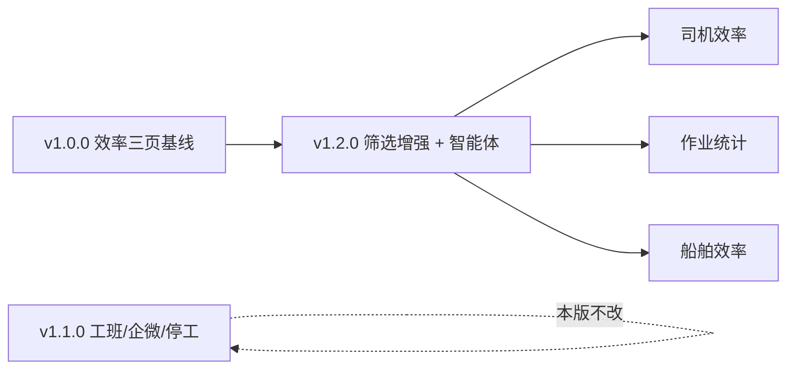
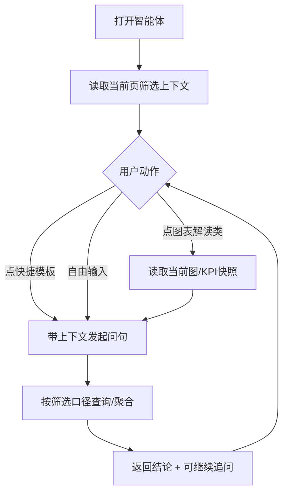

# 武港联投 · 单机作业量统计 — v1.2.0 产品需求文档（PRD）

| 项目 | 内容 |
|---|---|
| 版本号 | v1.2.0 |
| 版本更新日期 | 2026-11-04 |
| 版本定位 | **作业效率分析增强**：在 v1.0.0 效率三页基础上，补齐 **审核状态筛选**、**司机效率泊位多选**，并将原「智能问数」升级为页内 **效率智能体** |
| 终端形态 | **仅 PC 浏览器**（本版不交付企微 H5 / 独立 App） |
| 登录方式 | 统一平台登录（原型不画登录页） |
| 关联版本 | 工班填报 / 企微 H5 / 停工见 [v1.1.0 PRD](../v1.1.0/prd.html)；效率分析基线与系统配置见 [v1.0.0 PRD](../v1.0.0/prd.html) |
| 本版关键变更 | ① 司机效率 / 作业统计 / 船舶效率三页均支持「仅已通过」；② 司机效率新增泊位多选（默认全选）；③ 三页嵌入效率智能体（筛选上下文追问 / 图表解读 / 快捷问句模板） |
| 原型入口 | [prototype/versions/v1.2.0/index.html](../../../prototype/versions/v1.2.0/index.html) |

---

## 目录

- [一、结论摘要](#一结论摘要)
- [二、范围说明](#二范围说明)
- [三、核心业务规则](#三核心业务规则)
- [四、页面规格](#四页面规格)
- [五、效率智能体规格](#五效率智能体规格)
- [六、数据与筛选口径](#六数据与筛选口径)
- [七、权限矩阵](#七权限矩阵)
- [八、验收标准](#八验收标准)
- [九、场景说明](#九场景说明)
- [十、风险项](#十风险项)
- [十一、待确认](#十一待确认)

---

## 一、结论摘要

v1.2.0 只做 **PC 端作业效率分析增强**，不扩展工班填报与企微能力。用户在三页分析中可按 **审核状态** 收窄数据；司机效率可按 **泊位** 收窄；任意一页可打开 **效率智能体**，在当前筛选上下文下追问、解读图表或使用快捷问句。

| 能力 | 结论 | 优先级 |
|---|---|---|
| 交付范围 | 仅 PC 三页：司机效率、作业统计、船舶效率 + 版本入口 | P0 |
| 审核筛选 | 三页统一提供勾选框「仅已通过」；**默认不勾选 = 全部状态**；勾选后只统计已通过数据 | P0 |
| 泊位多选 | **仅司机效率**；默认全选启用泊位；多选后按泊位关联机械切片重算榜单与趋势 | P0 |
| 效率智能体 | 三页右下角入口；支持筛选上下文追问、图表解读、系统预置 + 我的快捷问句；可全屏 | P0 |
| 不改动 | 工班填报、企微 H5、停工、船舶调度、系统配置页（沿用既有版本） | — |

---

## 二、范围说明

### 2.1 包含（本版）

| 范围 | 终端 | 说明 | 优先级 |
|---|---|---|---|
| 司机效率页增强 | PC | 保留原榜单/趋势/机械/货种等能力；新增泊位多选、「仅已通过」、效率智能体 | P0 |
| 作业统计页增强 | PC | 保留产量趋势与结构分析；新增「仅已通过」、效率智能体 | P0 |
| 船舶效率页增强 | PC | 保留 KPI / 排名 / 明细；新增「仅已通过」、明细「审核」列、效率智能体 | P0 |
| 版本入口与侧栏 | PC | 侧栏仅挂上述三页；总入口可进入本版 | P0 |
| 原型演示数据 | PC | 船舶效率演示数据含已通过/未通过样例，便于验收筛选效果 | P0 |

### 2.2 不包含（本版）

| 不包含项 | 说明 |
|---|---|
| 企微 H5 / 独立 App | 本版不交付 |
| 工班作业、作业记录、停工 | 见 v1.1.0 |
| 船舶档案 / 船期 / 调度 / 大屏 | 见 v1.0.0 |
| 系统配置（设备/泊位/货种/字典/企微推送） | 见 v1.0.0；本版司机效率泊位选项 **读取** 泊位主数据中已启用泊位 |
| 审批流改动 | 本版只消费「是否已通过」结果做分析筛选，不改造审批过程 |
| 智能体大模型训练与知识库建设 | 本版定义产品交互与问句能力边界；具体模型与落库【待确认】 |

### 2.3 与既有版本关系

**文字解读**：v1.2.0 在 v1.0.0 效率分析能力上增量交付；不替代 v1.1.0 填报闭环。

---

## 三、核心业务规则

| 规则项 | 说明 | 优先级 |
|---|---|---|
| 页面集合 | 本版分析入口仅三页，侧栏不挂工班/配置等其它菜单 | P0 |
| 「仅已通过」默认值 | **默认不勾选**，统计范围为全部审核状态（含待审、已驳回、已通过等，具体状态枚举见【待确认】） | P0 |
| 「仅已通过」勾选后 | 仅纳入审核状态为「已通过」的作业/船次数据参与 KPI、榜单、图表与明细 | P0 |
| 筛选即时生效 | 勾选变更后刷新当前页分析视图；智能体上下文同步更新 | P0 |
| 泊位多选范围 | 仅 **司机效率**；选项来自泊位管理中 **已启用** 泊位；默认全选 | P0 |
| 泊位与机械关系 | 选中泊位后，仅保留映射到这些泊位的作业机械切片数据；未选任何泊位时榜单/图为空并提示 | P0 |
| 泊位与作业统计/船舶效率 | **本版不提供** 泊位筛选（作业统计、船舶效率仅审校筛选） | P0 |
| 智能体数据边界 | 问答与解读 **必须带入当前页筛选条件**（含审核、泊位、日期、货种等已选条件），禁止默认忽略筛选 | P0 |
| 智能体结果性质 | 本版定位为分析助手：出结论与解读，不代替正式报表导出盖章 | P1 |
| 数据权限 | 分析与智能体仅可见当前用户有权查看的组织/码头数据 | P0 |

---

## 四、页面规格

### 4.1 司机效率

| 项 | 规格 | 优先级 |
|---|---|---|
| 入口 | 侧栏「司机效率」；URL `?tab=master` | P0 |
| 既有能力 | 开班日区间、班次、货种一/二级、装船机/卸船机/门机多选、司机效率榜、每日作业量趋势、KPI | P0（继承） |
| 新增 · 泊位 | 多选下拉（全选/清空）；默认全选；摘要展示「全部 / 已选 N 个 / 具体名称」 | P0 |
| 新增 · 审核 | 勾选「仅已通过」；旁注状态提示（如「状态：全部 · 泊位：全部」） | P0 |
| 新增 · 智能体 | 右下角「智能体」；打开抽屉见第五章 | P0 |
| 交互 | 「查询」按钮刷新；筛选项变更可即时刷新（与原型一致即可） | P0 |

### 4.2 作业统计

| 项 | 规格 | 优先级 |
|---|---|---|
| 入口 | 侧栏「作业统计」；URL `?tab=volume` | P0 |
| 既有能力 | 周期产量示意、总量趋势（月/周/日/班）、产量结构四图、日表明细等 | P0（继承） |
| 新增 · 审核 | 顶栏保留「仅已通过」与状态提示；勾选后趋势与结构产量按已通过口径收敛 | P0 |
| 新增 · 智能体 | 同三页统一组件；快捷问句切换为作业统计模板 | P0 |
| 本版不做 | 泊位多选、机械多选（仍仅司机效率） | — |

### 4.3 船舶效率

| 项 | 规格 | 优先级 |
|---|---|---|
| 入口 | 侧栏「船舶效率」 | P0 |
| 既有能力 | 日期、船名、货种、装卸、岸电筛选；KPI；效率榜与对比条；作业明细 | P0（继承） |
| 新增 · 审核 | 勾选「仅已通过」；默认不勾选；勾选后剔除未通过船次 | P0 |
| 新增 · 明细列 | 明细表增加「审核」列：已通过 / 未通过（或等价文案） | P0 |
| 新增 · 智能体 | 快捷问句为船舶效率模板（Top5、在港偏长、岸电占比、解读排名等） | P0 |
| 口径（继承） | 在港=离泊−靠泊；生产用时=完工−开工−停工；单船效率=调度产量÷生产用时 | P0 |

### 4.4 信息架构（侧栏）

| 分组 | 菜单 | 优先级 |
|---|---|---|
| 作业效率分析 | 司机效率 / 作业统计 / 船舶效率 | P0 |
| 其它 | 本版侧栏 **不展示** | — |

---

## 五、效率智能体规格

> 相对 v1.0.0「智能问数」升级：从「预置问货种效率」扩展为 **带筛选上下文的分析助手**。

### 5.1 入口与布局

| 项 | 规格 | 优先级 |
|---|---|---|
| 入口 | 三页右下角悬浮按钮「智能体」 | P0 |
| 容器 | 右侧抽屉；支持全屏 / 退出全屏；遮罩点击关闭 | P0 |
| 顶部说明 | 标明：筛选上下文追问 · 图表解读 · 快捷问句 | P0 |
| 上下文区 | 展示当前页关键筛选（页面名、日期、审核、以及该页特有条件） | P0 |
| 快捷区 | 系统预置模板（随页面不同）+「我的快捷」（本地可创建/改名） | P0 |
| 对话区 | 用户气泡 / 助手气泡；发送框支持自由追问 | P0 |

### 5.2 能力清单

| 能力 | 说明 | 优先级 |
|---|---|---|
| 筛选上下文追问 | 用户无需重复口述已选条件；回答前默认带入当前筛选 | P0 |
| 图表解读 | 支持「解读当前趋势图 / 结构图 / 排名图」类问句；结合当前 KPI 或榜单要点输出 | P0 |
| 快捷问句模板 | 按页面预置 3～5 条高频问法；一键发起 | P0 |
| 我的快捷 | 可将上次问法存为快捷；可改名称 | P1 |
| 全屏阅读 | 长结果便于阅读 | P1 |

### 5.3 分页面预置问句（示例，可配置）

| 页面 | 预置问句（示例） | 优先级 |
|---|---|---|
| 司机效率 | 按当前筛选给出司机效率 Top5；白班 vs 夜班对比；解读效率趋势图；异常产量偏高司机 | P0 |
| 作业统计 | 按当前筛选给出区间总作业量；解读货种结构图；解读趋势拐点；白班夜班产量对比 | P0 |
| 船舶效率 | 单船效率 Top5；在港用时偏长船；解读船舶效率排名；岸电作业占比 | P0 |

### 5.4 主流程

**文字解读**：打开即锁定筛选；快捷或自由问都走同一回答链路；图表解读先取页面快照再作答。

---

## 六、数据与筛选口径

### 6.1 审核状态

| 项 | 说明 | 优先级 |
|---|---|---|
| 消费字段 | 工班班次/机台记录或船次分析行上的审核结果（至少区分：已通过 / 非已通过） | P0 |
| 司机效率 / 作业统计 | 勾选「仅已通过」后，产量、时长、效率指标只汇总已通过数据 | P0 |
| 船舶效率 | 勾选后列表、KPI、排名仅保留已通过船次；明细可展示审核标签 | P0 |
| 未勾选 | 含全部状态；界面提示「状态：全部」 | P0 |

### 6.2 泊位（仅司机效率）

| 项 | 说明 | 优先级 |
|---|---|---|
| 选项来源 | 泊位主数据 · 已启用 | P0 |
| 作用方式 | 泊位 → 关联作业设备 → 过滤机械切片后的司机效率数据 | P0 |
| 与机械多选 | 同时生效：取交集 | P0 |
| 空选 | 无数据，明确提示「未选机械/泊位」类文案 | P0 |

### 6.3 与既有分析口径关系

| 页面 | 继承口径 | 本版增量 |
|---|---|---|
| 司机效率 | 吨/小时；白/夜分列；有效作业时长等 | × 审核 × 泊位 |
| 作业统计 | 时间范围缩放趋势/结构 | × 审核 |
| 船舶效率 | 调度产量、在港、生产用时、单船效率 | × 审核 |

---

## 七、权限矩阵

| 角色 | 司机效率 | 作业统计 | 船舶效率 | 智能体 | 优先级 |
|---|---|---|---|---|---|
| 数据查看人 | 查看 + 筛选 | 查看 + 筛选 | 查看 + 筛选 | 可用 | P0 |
| 填报人 | 可查看本权限范围分析 | 同左 | 同左 | 可用 | P0 |
| 审批人 | 可查看 | 可查看 | 可查看 | 可用 | P0 |
| 配置员 | 不依赖本版改配置 | — | — | — | — |

> 细粒度组织隔离规则沿用平台；本版不新增独立权限码时，复用「效率分析查看」权限。【待确认】是否拆分智能体单独权限。

---

## 八、验收标准

| 编号 | 验收项 | 优先级 |
|---|---|---|
| A1 | 版本入口可进入三页；侧栏仅三页 | P0 |
| A2 | 三页均有「仅已通过」；默认不勾选；勾选后数据量/指标相对全部状态减少或剔除未通过样例 | P0 |
| A3 | 司机效率泊位默认全选；取消部分泊位后榜单/趋势变化；清空后空态提示 | P0 |
| A4 | 作业统计、船舶效率 **无** 泊位筛选控件 | P0 |
| A5 | 船舶效率明细可见审核列；勾选仅已通过后未通过船次不出现 | P0 |
| A6 | 三页均可打开智能体；上下文区展示当前审核等筛选 | P0 |
| A7 | 点击预置「解读…」类问句有可读结论；自由追问声明沿用当前筛选 | P0 |
| A8 | 智能体可全屏、可关闭；我的快捷可创建（允许原型 localStorage） | P1 |

---

## 九、场景说明

### 9.1 正常流程

| 场景 | 步骤 | 期望 |
|---|---|---|
| 查看全部状态效率 | 进入司机效率，不勾选「仅已通过」，点查询 | 展示全部状态汇总 |
| 只看已通过 | 勾选「仅已通过」并查询 | KPI/榜/图仅已通过 |
| 按泊位看司机 | 多选部分泊位 | 仅关联机械数据参与计算 |
| 智能体追问 | 设好筛选后打开智能体，点 Top5 模板 | 回答明示当前筛选条件 |
| 船舶剔未通过 | 船舶效率勾选仅已通过 | 未通过船次从榜与明细消失 |

### 9.2 边界情况

| 场景 | 期望 |
|---|---|
| 泊位清空 | 司机效率无数据空态，不报错 |
| 仅已通过且本区间无已通过数据 | 空态或全 0，文案可读 |
| 作业统计仅改审核、时间范围不变 | 趋势/结构数值随审核收敛 |
| 智能体打开时再改页面筛选 | 再次提问前上下文刷新为最新筛选 |

### 9.3 异常兜底

| 场景 | 期望 |
|---|---|
| 泊位主数据加载失败 | 提示失败；可降级为固定泊位列表或禁用泊位筛选并明示 |
| 智能体服务不可用 | 抽屉可打开；发送后提示「助手暂不可用」，不阻塞页面分析 |
| 无权限查看分析 | 拦截进入并提示无权限 |

---

## 十、风险项

| 风险 | 影响 | 缓解 | 优先级 |
|---|---|---|---|
| 「全部状态」枚举未最终对齐审批状态机 | 筛选口径与业务不一致 | 与 v1.1.0 审批状态对齐后固化；见待确认 | P0 |
| 泊位–机械映射与现场配置不一致 | 司机效率按泊位结果偏差 | 明确以泊位管理绑定设备为准；联调校验 | P0 |
| 智能体自由问答超出数据权限或编造数字 | 误导现场决策 | 强制带筛选；无数据时明确「无匹配」；禁止臆造【待确认】模型护栏 | P0 |
| 效率页与填报页数据延迟 | 刚通过审核但分析未刷新 | 约定刷新策略或提示数据截止时间 | P1 |

---

## 十一、待确认

| 编号 | 事项 | 说明 |
|---|---|---|
| T1 | 「全部状态」具体枚举 | 是否含：草稿 / 审批中 / 已驳回 / 已通过；作业统计与司机效率是否按班次单据还是按小时行状态 |
| T2 | 船舶效率「未通过」定义 | 对应调度完工审核、还是工班审批，或二者之一未通过即排除 |
| T3 | 泊位–机械映射规则 | 是否严格按泊位管理 `deviceCodes`；设备跨泊位绑定时如何归属 |
| T4 | 智能体实现形态 | 规则引擎 / 对接问数中台 / 大模型；是否落审计日志 |
| T5 | 智能体权限 | 是否与「效率查看」共用，或单独授权 |
| T6 | 作业统计顶栏 | 除「仅已通过」外，是否还要在本版补泊位筛选（当前明确不做） |
| T7 | 数据刷新时效 | 审核通过后分析库同步时延（实时 / T+分钟 / 定时） |

---

## 附录 · 交付物清单

| 类型 | 路径 |
|---|---|
| PRD 源码 | `docs/versions/v1.2.0/prd.md` |
| PRD 阅读页 | `docs/versions/v1.2.0/prd.html` |
| 原型入口 | `prototype/versions/v1.2.0/index.html` |
| 司机效率 / 作业统计 | `prototype/versions/v1.2.0/pages/work-stat-efficiency-pc.html` |
| 船舶效率 | `prototype/versions/v1.2.0/pages/work-stat-ship-eff-pc.html` |
